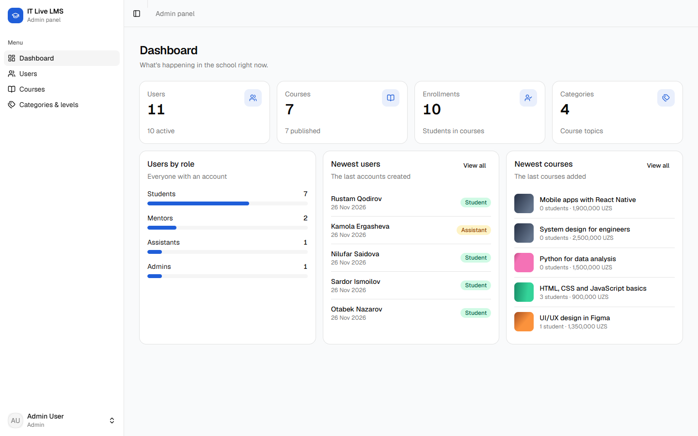
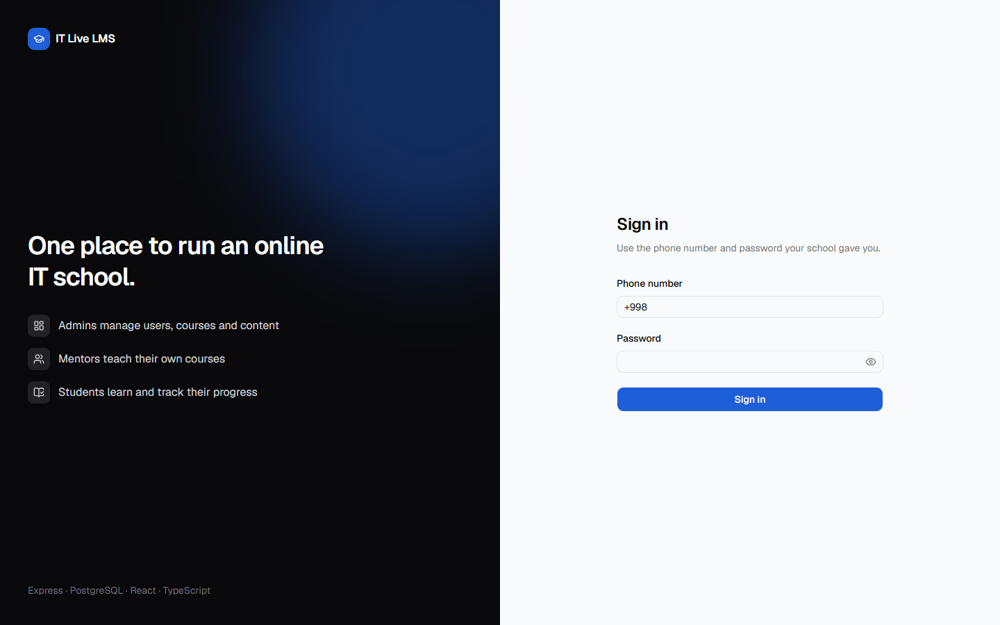
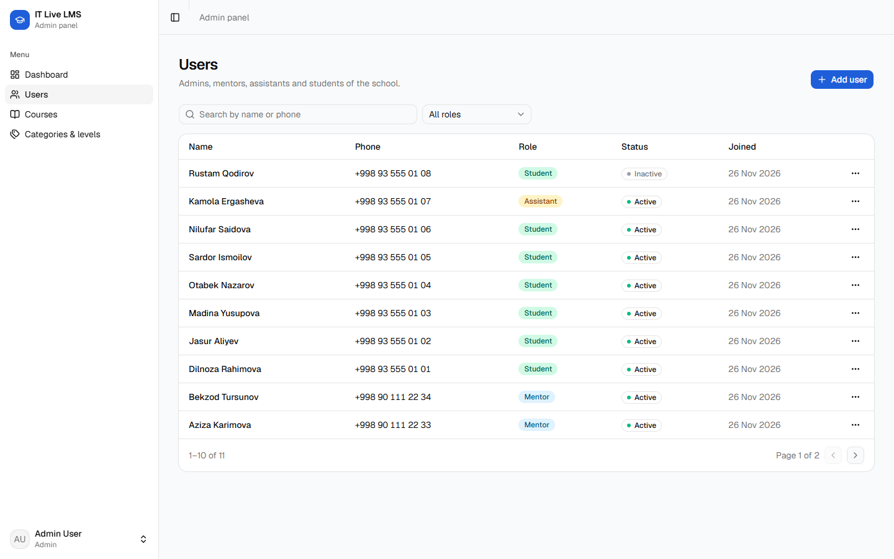
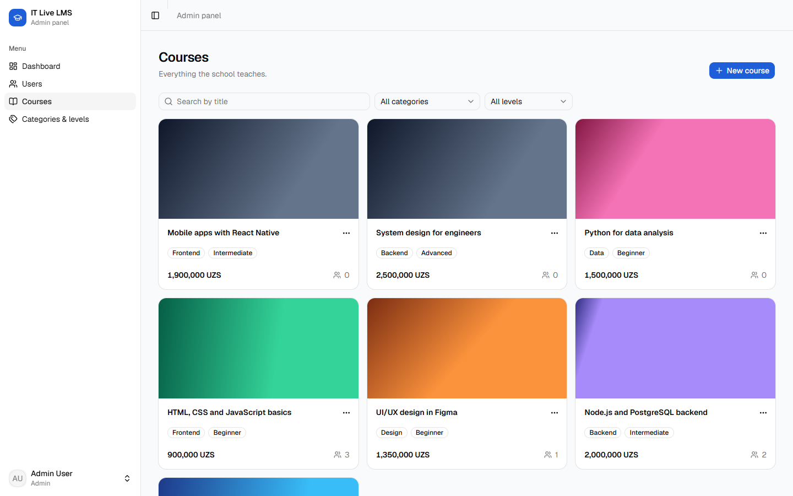
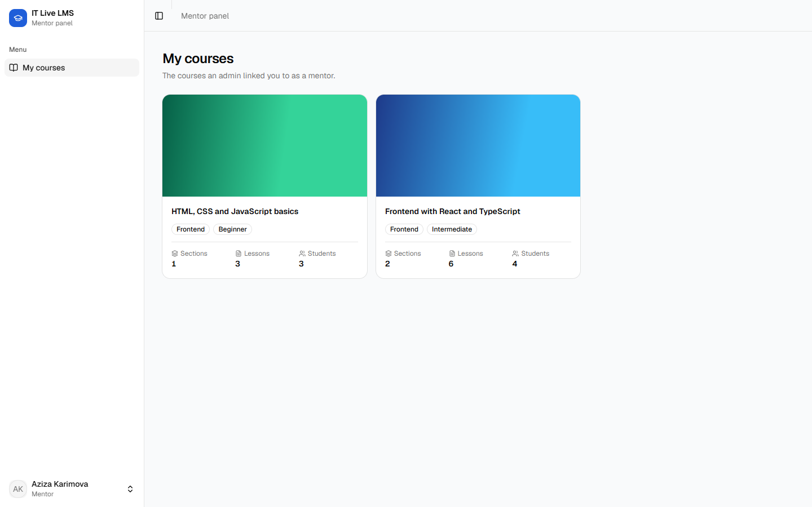
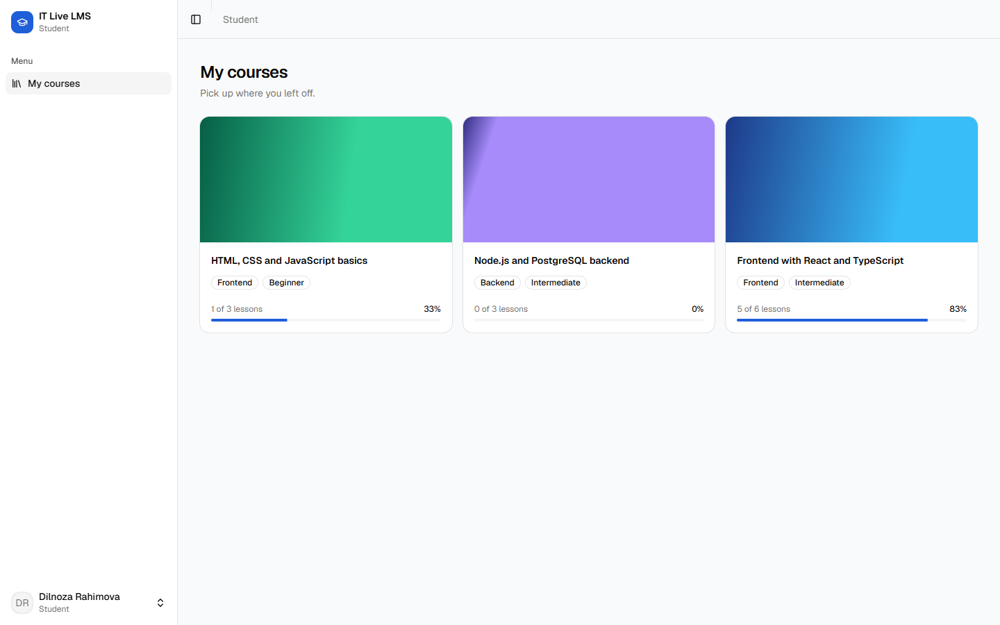
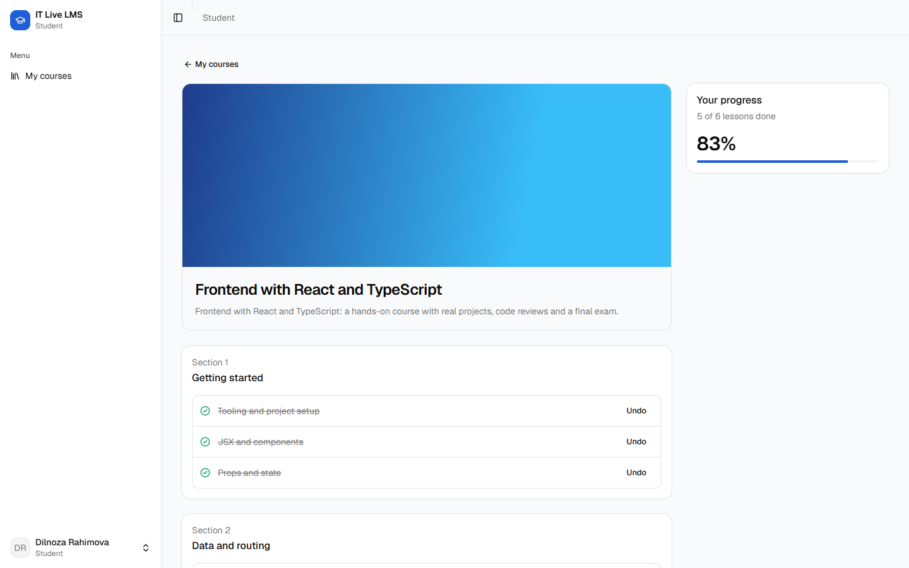

# IT Live LMS

A learning management system for an online IT school. Admins build
courses (sections → lessons → materials, assignments and exams), mentors
teach and grade, and students learn and track their progress.

> **Status: working MVP.** The API for all three roles is done and covered
> by Postman tests, and the React app has the login, the admin dashboard
> (stats, users, courses, categories and levels), the mentor's courses and
> the student's courses with progress. See [What's built](#whats-built).



## Roles

| Role      | What they do                                                        |
| --------- | ------------------------------------------------------------------- |
| Admin     | Manages users, courses and their content, payments and comments     |
| Mentor    | Manages their own courses, grades assignments and exams             |
| Assistant | Helps mentors with their courses                                    |
| Student   | Takes enrolled courses, watches lessons, does assignments and exams |

## Tech stack

- **Language:** TypeScript (server and client)
- **Database:** PostgreSQL 18, run with Docker Compose
- **Backend:** Node.js 24, Express 5
- **Frontend:** React 19, Vite 8, React Router, TanStack Query,
  react-hook-form + zod, Tailwind CSS 4, shadcn/ui (Radix), lucide icons
- **Tooling:** ESLint, Prettier, concurrently
- **Planned:** deployment to a Linux server

## Project structure

```
client/                  React app (Vite). Calls the API through /api
  src/router.tsx         pages and which role may open them
  src/lib/api.ts         fetch wrapper: JSON or form-data in, ApiError out
  src/features/auth/     login page, who-am-I, role guard
  src/features/admin/    dashboard, users, courses, categories and levels
  src/features/mentor/   the mentor's courses
  src/features/student/  the student's courses, lessons, progress
  src/components/        app shell (sidebar), loading/empty/error states
  src/components/ui/     shadcn/ui components (generated)
server/                  Express API
  demo/banners/          banner images used by the demo-data seed
  src/app.ts             middleware and routes
  src/routes/            URL → controller
  src/controllers/       read the request, send the response
  src/services/          SQL queries
  src/schemas/           request validation (zod)
  src/middleware/        auth check, JSON errors
  src/utils/             JWT, error logger, file uploads (multer), SQL helpers
  src/scripts/seed.ts    roles and the first admin
  src/scripts/seed-demo.ts  demo courses, users, lessons and progress
  logs/error.log         server errors (created on the first error, not in git)
  uploads/               uploaded files, served at /uploads (not in git)
docs/database/           database schema (source of truth)
docs/how-it-works.md     how the project works, in Russian
docs/screenshots/        screenshots of the app
postman/                 Postman collection, environment, fixtures/ (test files)
docker-compose.yml       PostgreSQL for local development
```

## Getting started

Requirements: Node.js 24+, Docker Desktop.

```bash
# 1. Database: copy .env.example to .env, fill in the values, then
docker compose up -d

# 2. Install (once): root, server and client
npm install
npm install --prefix server
npm install --prefix client

# 3. API settings: copy server/.env.example to server/.env and fill it in,
#    then create the roles and the first admin
npm --prefix server run db:seed

# 4. API (http://localhost:4000) and client (http://localhost:5173) together
npm run dev
```

Open http://localhost:5173 and sign in with `SEED_ADMIN_PHONE` /
`SEED_ADMIN_PASSWORD` from `server/.env`. `npm run dev:server` and
`npm run dev:client` start one side only.

In development, Vite forwards every request starting with `/api` (and the
uploaded files under `/uploads`) to the Express server, so the browser
only talks to one address and the login cookie just works. To point the
client at an API on another port: `API_PROXY_TARGET=http://localhost:4100
npm run dev:client`.

### Demo data (optional)

To fill an empty database with realistic content (6 courses with
banners, 2 mentors, an assistant, 6 students, sections, lessons,
enrollments and some progress), set `SEED_DEMO_PASSWORD` in
`server/.env` and run:

```bash
npm --prefix server run db:seed-demo
```

It runs in one transaction and does nothing if the demo users already
exist. The demo accounts all use `SEED_DEMO_PASSWORD`; their phones
(`+998 00 …`, not a real operator code) are printed at the end, for
example mentor `+998000000201` and student `+998000000401`.

## Production build

```bash
npm run build                    # client → client/dist, server → server/dist
NODE_ENV=production npm start    # one Node process on PORT
```

With `NODE_ENV=production` Express also serves `client/dist` and sends
`index.html` for page URLs such as `/admin/users`, so the site, the API
and `/uploads` share one address and the login cookie needs no CORS. The
`Dockerfile` builds the same thing into one image (Node 24 Alpine, runs
as the `node` user):

```bash
docker build -t it-live-lms .
docker run -p 4000:4000 --env-file server/.env -e NODE_ENV=production   -v lms-uploads:/app/server/uploads it-live-lms
```

Inside the container, `DATABASE_URL` must point at a database the
container can reach. Run the seeds there with `npm run db:seed:prod` and
`npm run db:seed-demo:prod`. Uploads live on disk, so keep
`/app/server/uploads` on a volume.

## Screenshots

| Sign in                                          | Users                                                  |
| ------------------------------------------------ | ------------------------------------------------------ |
|            |              |
| **Courses**                                      | **Mentor: my courses**                                 |
|    |          |
| **Student: my courses**                          | **Student: a course with progress**                    |
|  |  |

The data in the screenshots was created through the app's own API on a
local test database.

## The client

| Page                   | Role     | What it does                                                                                                                                 |
| ---------------------- | -------- | -------------------------------------------------------------------------------------------------------------------------------------------- |
| `/login`               | everyone | Phone + password, field errors, wrong-password and server-down messages                                                                      |
| `/admin`               | admin    | Stats cards and users by role from `GET /admin/stats`, newest users and courses                                                              |
| `/admin/users`         | admin    | Table with search (name or phone), role filter and pagination; add a user; activate/deactivate; delete with confirmation                     |
| `/admin/courses`       | admin    | Course cards with search, category and level filters, pagination; create and edit with a banner upload (form-data); delete with confirmation |
| `/admin/catalog`       | admin    | Add and delete categories and levels (a course needs both)                                                                                   |
| `/mentor`              | mentor   | My courses with section, lesson and student counts                                                                                           |
| `/student`             | student  | My courses with progress bars                                                                                                                |
| `/student/courses/:id` | student  | Sections and lessons; mark a lesson as done or undo it, progress updates                                                                     |

- **Who may open what.** `RequireRole` asks `GET /auth/me` who is logged in.
  Logged out → `/login` (and back to the page after signing in); wrong
  role → that role's own home. The server still checks every request;
  the guard only decides what to show.
- **Session expiry.** Any API answer with 401 clears the cached user, so the
  app goes back to the login page by itself.
- **Server state** lives in TanStack Query (cache, loading and error
  states, refetch after a change); forms use react-hook-form with zod
  schemas that mirror the server's, and the server's own 400/409 field
  errors are shown under the matching field.
- Every list has a loading skeleton, an empty state and an error state
  with "Try again".

## API

| Method | Path                  | Auth   | Description                                                                   |
| ------ | --------------------- | ------ | ----------------------------------------------------------------------------- |
| GET    | `/api/health`         | -      | Server and database status (200, or 503 if the DB is down)                    |
| POST   | `/api/v1/auth/login`  | -      | Phone (`+998` + 9 digits) + password; sets an httpOnly `token` cookie (1 day) |
| GET    | `/api/v1/auth/me`     | cookie | The logged-in user                                                            |
| POST   | `/api/v1/auth/logout` | -      | Deletes the `token` cookie (204)                                              |

Admin routes, all under `/api/v1/admin`. They need the cookie of a user
with the `admin` role: 401 without a cookie, 403 for other roles.

**Dashboard and users**

| Method | Path         | Description                                                                                                                                                |
| ------ | ------------ | ---------------------------------------------------------------------------------------------------------------------------------------------------------- |
| GET    | `/stats`     | Counts for the dashboard cards: users (total, active, per role), courses, categories, enrollments, payments and revenue                                    |
| GET    | `/users`     | `?role=student&search=&status=true&page=1&limit=10` (search by name or phone), returns `{ users, page, limit, total }`                                     |
| GET    | `/users/:id` | Full profile (mentor fields, `courses_count`), never the password hash                                                                                     |
| POST   | `/users`     | `full_name`, `phone`, `password` (8+), `role`, optional `email`, `status`, mentor fields and a `profile_img` file. 201; 409 if the phone or email is taken |
| PATCH  | `/users/:id` | Any of the same fields; a new password is hashed. `{ "status": false }` deactivates. An admin can't deactivate or demote themselves                        |
| DELETE | `/users/:id` | 204; 409 if the user has payments (deactivate instead); an admin can't delete themselves                                                                   |

**Catalog.** `categories`, `levels` and `courses` each have the same five
routes: `GET /<name>`, `GET /<name>/:id`, `POST /<name>`,
`PATCH /<name>/:id`, `DELETE /<name>/:id`.

- `GET /courses` takes `?search=&category_id=&level_id=&status=true|false&page=1&limit=10`
  and returns `{ courses, page, limit, total }`. Categories and levels
  come as one list with `courses_count`.
- A category or level `slug` is made from the title when it isn't sent;
  a duplicate slug answers 409.
- An unknown `category_id` / `level_id` on a course answers 400 for that
  field. Deleting a category or level that courses use, or a course with
  payments, answers 409.
- Course `price` is returned as a string (`"1200000.00"`): PostgreSQL
  `NUMERIC` is exact, and it stays exact in JSON.

**Course content** (course → sections → lessons → materials, exercises, exams → questions). List and
create go under the parent, everything else uses the item's own id:

| Method             | Path                           | Description                                                          |
| ------------------ | ------------------------------ | -------------------------------------------------------------------- |
| GET, POST          | `/courses/:courseId/sections`  | Sections of a course, ordered by `position`; 404 if no course        |
| GET, PATCH, DELETE | `/sections/:id`                | One section (GET includes its lessons)                               |
| GET, POST          | `/sections/:sectionId/lessons` | Lessons of a section: `title`, `description`, file `video`           |
| GET, PATCH, DELETE | `/lessons/:id`                 | One lesson (GET includes its materials and their files)              |
| GET, POST          | `/lessons/:lessonId/materials` | Materials of a lesson: `description`, files under `files` (up to 20) |
| GET, PATCH, DELETE | `/materials/:id`               | One material; new `files` in a PATCH replace the old ones            |
| GET, POST          | `/lessons/:lessonId/exercises` | Homework tasks of a lesson: `title`, files under `files`             |
| GET, PATCH, DELETE | `/exercises/:id`               | One exercise                                                         |
| GET, POST          | `/lessons/:lessonId/exams`     | Exams of a lesson (`title`, `pass_percent`, default 60)              |
| GET, PATCH, DELETE | `/exams/:id`                   | One exam (GET includes its questions with the correct answers)       |
| GET, POST          | `/exams/:examId/questions`     | Questions: `question`, `answer_a`…`answer_d`, `correct_answer` a–d   |
| GET, PATCH, DELETE | `/questions/:id`               | One question                                                         |
| GET                | `/courses/:courseId/students`  | Enrolled students with their progress (lessons done / all lessons)   |
| GET                | `/courses/:courseId/results`   | Every exam attempt in the course, newest first                       |

A material and its files are saved in one transaction (all or nothing).
Deleting a course, section or lesson deletes everything inside it.

**File uploads.** Requests that carry files are `multipart/form-data`
(Postman: Body → form-data), with the text fields next to the files:

| Where              | Key           | Accepted                                                       | Max    |
| ------------------ | ------------- | -------------------------------------------------------------- | ------ |
| Course             | `banner`      | image: jpg, png, webp, gif (required on create)                | 500 MB |
| Course             | `intro_video` | video: mp4, webm, mov                                          | 500 MB |
| Lesson             | `video`       | video: mp4, webm, mov                                          | 500 MB |
| Material, exercise | `files`       | pdf, zip, rar, doc(x), ppt(x), xls(x), txt, png, jpg; up to 20 | 50 MB  |
| User               | `profile_img` | image: jpg, png, webp, gif                                     | 5 MB   |

The server saves them in `server/uploads/` (not in git) with random names
and stores the path, e.g. `/uploads/banners/<uuid>.png`, which it also
serves. A wrong type or size answers 400 for that field. The files of a
request that fails are deleted, and so are replaced files and the files of
deleted courses, sections, lessons, materials, exercises and users.
Numbers and `true`/`false` are accepted as text, the way form-data sends
them.

**Course members** (admin only). Payments aren't built yet, so the admin
links mentors and enrolls students by hand:

| Method    | Path                                  | Description                                                           |
| --------- | ------------------------------------- | --------------------------------------------------------------------- |
| GET, POST | `/courses/:courseId/mentors`          | `{ "user_id": 5 }`; 400 if the user isn't a mentor, 409 if already in |
| DELETE    | `/courses/:courseId/mentors/:userId`  | Unlink a mentor                                                       |
| POST      | `/courses/:courseId/students`         | `{ "user_id": 7 }`; 400 if not a student, 409 if already enrolled     |
| DELETE    | `/courses/:courseId/students/:userId` | Unenroll (progress and results are kept)                              |

**Mentor panel** `/api/v1/mentor` (role `mentor`). The mentor works only
in the courses they are linked to; anything else answers 403.

| Method | Path                       | Description                                                                                                                                  |
| ------ | -------------------------- | -------------------------------------------------------------------------------------------------------------------------------------------- |
| GET    | `/courses`                 | My courses with sections, lessons and students counts                                                                                        |
| GET    | `/courses/:id`             | One of my courses with its sections                                                                                                          |
| …      | every course content route | The same content routes as the admin's (sections, lessons, materials, exercises, exams, questions, students, results), limited to my courses |

Mentors can't create courses, change users or enroll students.

**Student side** `/api/v1/student` (role `student`). Only enrolled courses
that are switched on; anything else answers 403.

| Method       | Path                    | Description                                                                                             |
| ------------ | ----------------------- | ------------------------------------------------------------------------------------------------------- |
| GET          | `/courses`              | My courses with `lessons_done`, `lessons_total` and `progress_percent`                                  |
| GET          | `/courses/:id`          | Sections and lessons, each lesson with `completed`                                                      |
| GET          | `/lessons/:id`          | Video, materials, exercises, exams (no answers) and `completed`                                         |
| POST, DELETE | `/lessons/:id/complete` | Mark a lesson as done / not done (marking twice is fine)                                                |
| GET          | `/exams/:id`            | The questions without the correct answers                                                               |
| POST         | `/exams/:id/attempts`   | `{ "answers": [{ "question_id": 5, "answer": "b" }] }`: the server counts the score; unanswered = wrong |
| GET          | `/results`              | All my exam attempts                                                                                    |

Errors are always JSON: `{ "error": "..." }`, plus `details` for
validation errors (400). The client gets only "Internal server error" for
a 500; the real cause goes to the terminal and to `server/logs/error.log`
(time in Tashkent, method and path, stack trace; request bodies are never
logged).

### Testing the API with Postman

The `postman/` folder has a collection with every request and a test on
each one (status codes, response shape, no password hash, the cookie,
the error cases).

1. In the Postman app: **Import** → select both files in `postman/`
   (choose **Replace** if it says the collection already exists).
2. **Settings → General → Working directory**: choose this repo's
   `postman/` folder. The upload requests take their test files from
   `postman/fixtures/`.
3. Select the **IT Live LMS (local)** environment and fill in
   `adminPhone` and `adminPassword` (`SEED_ADMIN_PHONE` and `SEED_ADMIN_PASSWORD` from `server/.env`).
4. With the database and server running, open the collection and click
   **Run**.

Or from the terminal with the [Postman CLI](https://learning.postman.com/docs/postman-cli/postman-cli-overview/):

```bash
postman collection run postman/it-live-lms.postman_collection.json \
  -e postman/local.postman_environment.json --working-dir postman \
  --env-var "adminPhone=+998901234567" --env-var "adminPassword=..."
```

## Database

19 tables in two files, split so each one can be imported into
[drawSQL](https://drawsql.app) as a diagram (the free plan allows 15
tables per diagram), plus one setup file:

| File                                   | Contents                                              |
| -------------------------------------- | ----------------------------------------------------- |
| `drawsql-1-users-courses-payments.sql` | users, roles, courses, mentors, enrollments, payments |
| `drawsql-2-course-content.sql`         | sections, lessons, materials, exams, progress         |
| `setup-timezone-and-triggers.sql`      | Tashkent time zone, auto-updating `updated_at`        |

Docker Compose loads all three automatically the first time the database
starts with an empty volume. A database that already has data gets later
changes from `docs/database/migrations/` (each file says how to run it):
`001-course-mentors.sql` adds the mentor ↔ course link.

## What's built

- [x] Database schema
- [x] Project setup: Docker database, Express + TypeScript API, React +
      TypeScript client, connected through a proxy
- [x] API connected to the database (`GET /api/health` reports server and
      database status)
- [x] Login by phone and password (JWT in an httpOnly cookie), who-am-I,
      logout, JSON errors with an error log file
- [x] Admin: users (list, search, create, edit, activate/deactivate, delete) and dashboard stats
- [x] Admin: categories, levels and courses (CRUD with search, filters and
      pagination)
- [x] Admin: sections, lessons, materials
- [x] File uploads (form-data): course banner and intro video, lesson
      video, material and exercise files, profile photo
- [x] Student API: my courses with progress, lessons, marking lessons done, exams scored on the server, my results
- [x] Mentor API: my courses, the same content tools limited to them, students with progress, exam results
- [x] Admin: exercises, exams and questions; linking mentors and enrolling students
- [x] React client: login with a role guard, admin dashboard (stats,
      users, courses, categories and levels), mentor courses, student
      courses with lesson progress
- [ ] Client screens for course content (sections, lessons, materials,
      exams), linking mentors and enrolling students, editing users
- [ ] Grading homework (needs a submissions table), deploy
- [ ] Payments, comments, certificates, landing page

## Credits

UI design: IT Live Academy (Figma).
